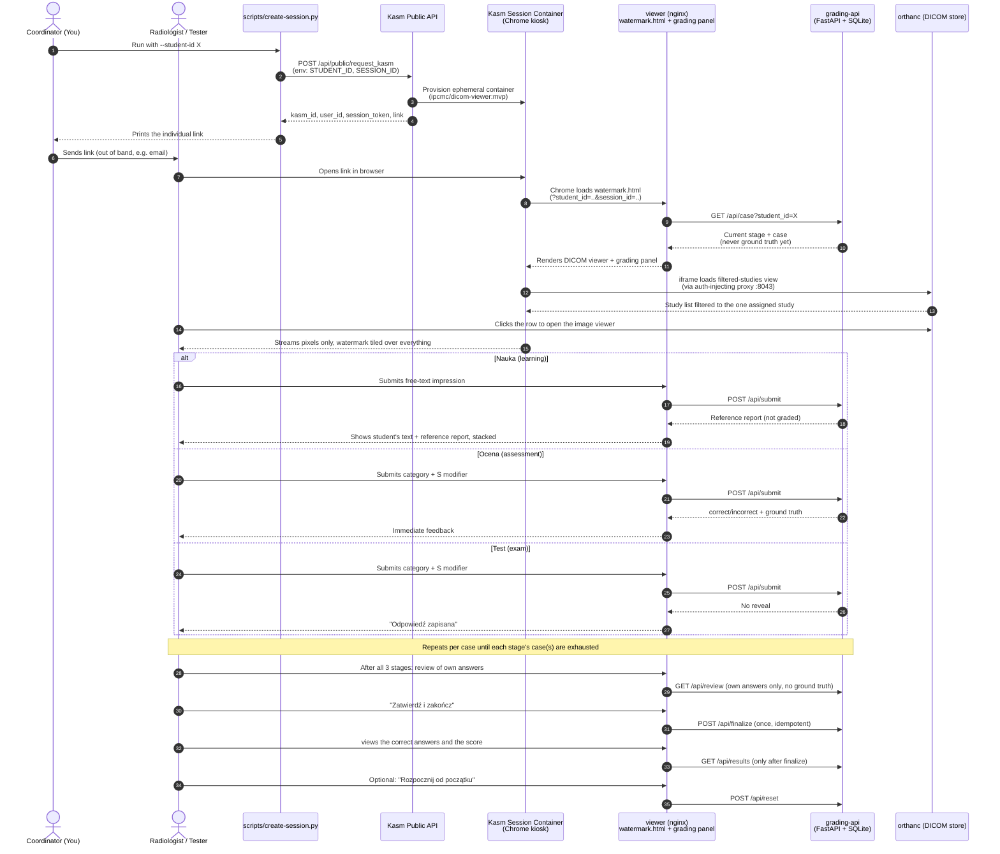
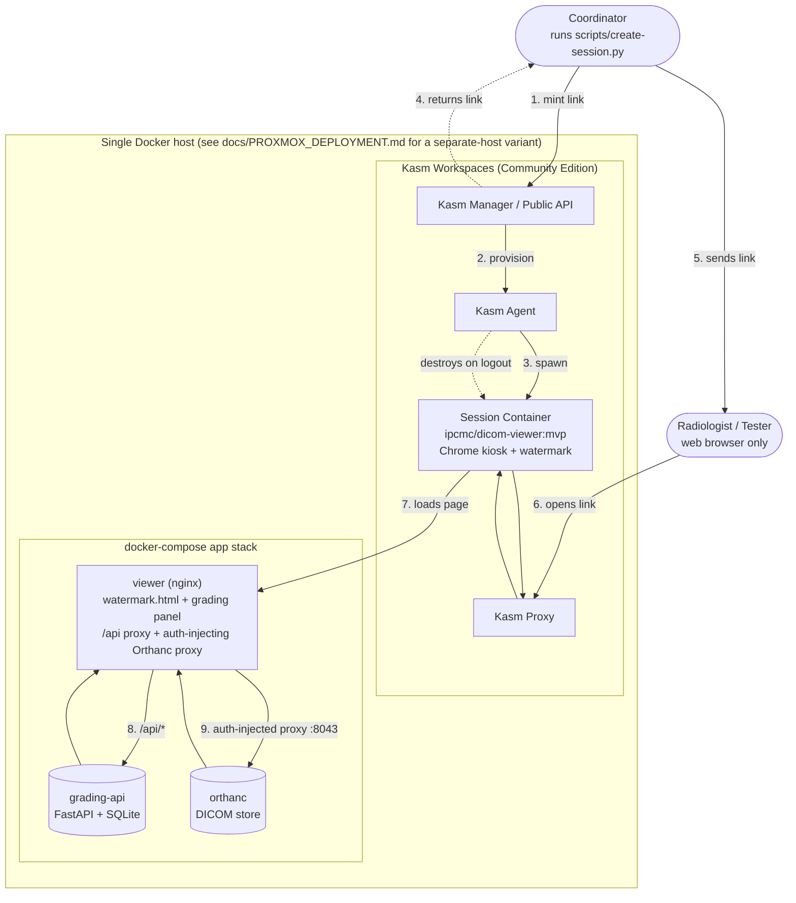
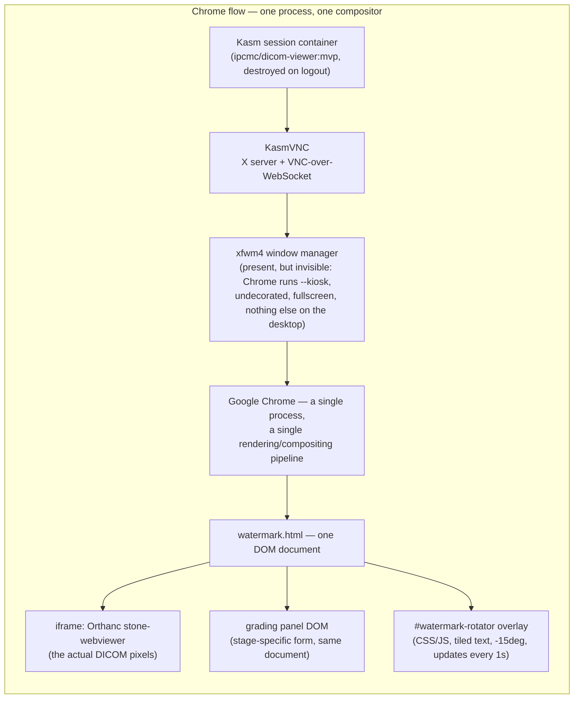
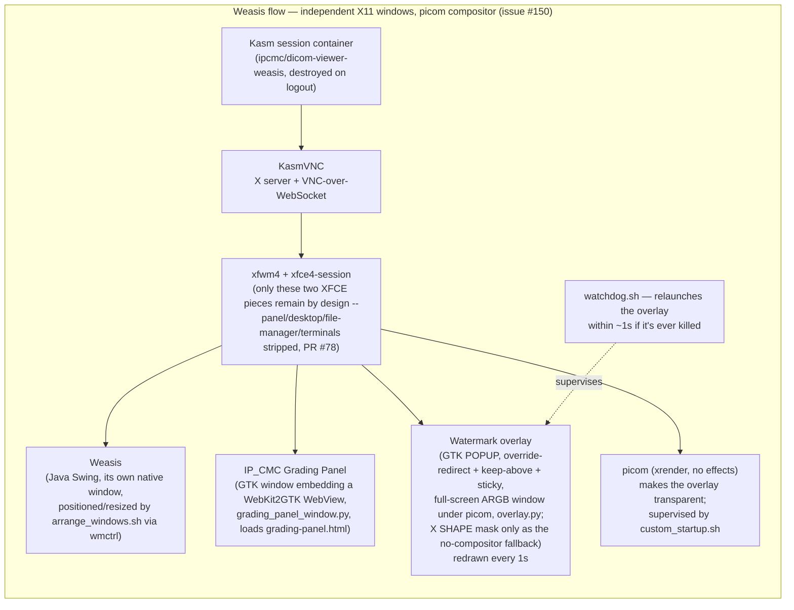

# Architecture — current state

**This describes what's actually built and running today**, not the
target/future system. For what's deliberately deferred (Moodle, payments,
real stratified sampling, certificates, admin dashboard), see README.md's
"What's NOT in this MVP" section and CLAUDE.md's hard rules — not
duplicated here to avoid the two documents drifting apart again.

## Session flow

Key differences from the original design discussion worth calling out
explicitly: no Moodle launches this (a coordinator runs
`create-session.py` by hand), no payment gate, no LTI grade passback, and
`GET /case` / `POST /submit` enforce that ground truth and the reference
report are never sent to the browser before the stage that's supposed to
reveal them — that rule lives in `grading-api/app/main.py`, not just this
diagram.

## Deployment topology

"Single Docker host" is currently this dev laptop, not yet anything
reachable from the GUMed/UCK network — see `docs/PROXMOX_DEPLOYMENT.md`
for the separate-host variant. Kasm Workspaces is installed as Community
Edition, which comes with real licensing constraints (non-commercial-use
restriction, 5-concurrent-session cap) — see CLAUDE.md's hard rules, not
this diagram, for the authoritative statement of those.

Notes on what this diagram deliberately does *not* show, because it
doesn't exist yet: Moodle, a payment gateway, LTI Advantage, a
Postgres/stratified-sampling layer, a Proxmox cluster (this is one host).
Each of those is a real, tracked gap — see README.md and CLAUDE.md, not
this diagram, for the authoritative list so the two don't drift apart.

The two diagrams above show the **Chrome** workspace (`ipcmc/dicom-viewer:mvp`). The
**Weasis** workspace (`docker/kasm-workspace-weasis/`, milestone "Weasis viewer migration",
issues #3-#8) is built and is the one the demos and live tests use (docs/DEMO.md): it
auto-launches Weasis on the assigned study, shows the grading panel in its own window, runs
the native watermark overlay, and follows the case pointer when the doctor moves on (#185).
`scripts/create-session.py` mints links for either workspace: it launches whatever Kasm image
`KASM_IMAGE_ID` names, so the session flow is the same sequence with Weasis in place of the
Chrome kiosk (the layer breakdown below shows how the two differ on screen). A third path,
Apache Guacamole, runs the same Weasis image as a PoC (README.md's Guacamole section,
`scripts/provision-guacamole-session.py`); it is not drawn here.

## Display layer stack — what the user actually sees

Both flows end in "pixels inside a KasmVNC-streamed browser tab," but
*how* those pixels get composited is structurally different between them —
worth spelling out explicitly, because that difference is also the root
cause of at least one real, currently-open display bug (see below).

The Chrome flow's three visible pieces (viewer iframe, grading panel,
watermark) are DOM elements inside **one** document, painted by **one**
browser compositor in a single atomic frame. There is no window stacking
to arbitrate and no exposure/redraw handshake between independent
processes — the watermark's per-second re-render is just another DOM
repaint, invisible as a discrete event.

The Weasis flow has none of that: Weasis, the grading panel, and the
watermark overlay are three **separate X11 clients**, stacked and
arbitrated by `xfwm4`.

**Screen flash (issue #150) — diagnosed, then fixed.** The overlay used to rely on
the X **Shape** extension alone (no compositor ran): only the glyph pixels were part
of the watermark window, and that shape was recomputed every second on a full-screen,
always-on-top window. Each change made the X server treat the area the old shape had
covered as newly exposed, and Weasis (Java Swing, nothing to paper over partial
repaints) redrew it: a visible flash once a second, absent in the Chrome flow, which
has a single compositor. The fix (PR #155) runs **picom** in the Weasis image, with
every effect off so the radiology image is never altered (`picom.conf`), and makes
the overlay a genuinely transparent ARGB window; nothing is reshaped any more. If
picom is not running, `overlay.py` falls back to the Shape mask, so a dead
compositor never turns the viewer black; the tile density is the same in both modes
(`WATERMARK_TILES_PER_SCREEN`, default 3 per screen, which also keeps the fallback
shape small). Measured flashes per 3 minutes in live sessions: 7 with
the per-second shape, 0 with picom (CHANGELOG.md). `scripts/test-overlay-compositor.sh`
and `scripts/test-overlay-shape.sh` pin both modes in CI.

**Visual regression testing does not catch this, structurally, for three
independent reasons** (`docker/viewer/tests/test_visual_regression.py`,
PR #77):
1. Those tests screenshot `watermark.html`/`grading-panel.html` directly
   via Playwright's own Chromium, outside any Kasm container — they never
   touch `xfwm4`, `overlay.py`, or Weasis's real native window at all, for
   either flow.
2. Even pointed at a live session, pixelmatch-style diffing compares two
   static single points in time. A one-frame flash is a temporal artifact
   between those two points, not a difference between them — this class
   of tool cannot see it by construction, only frame-by-frame video
   capture could.
3. The suite's own determinism trick works directly against it: it
   freezes the clock (`page.clock.set_fixed_time`) specifically so the
   once-a-second redraw never fires during a screenshot. That's what makes
   the tests reproducible, and it's exactly the mechanism that would need
   to fire for this bug to appear.
