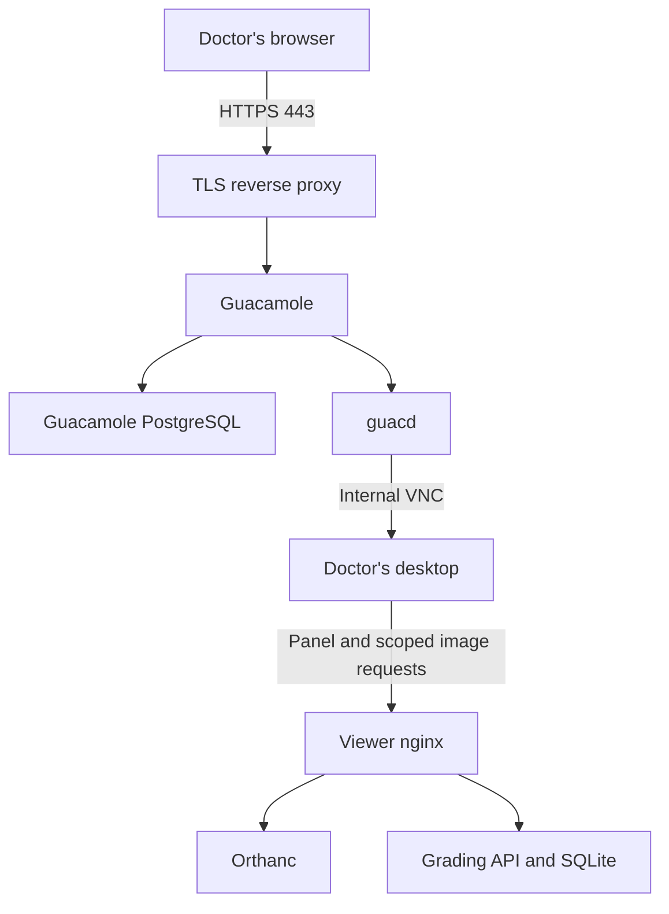

# Port exposure and administrator bootstrap (#103)

## Purpose and scope

This change implements the original issue's loopback defaults, stock-password
remediation and resolved-Compose gate. It does **not** complete the broader
[HTTPS-only proposal](https://github.com/xWuWux/DICOM_app_viewer/issues/103#issuecomment-6336096757).
All host mappings, including optional monitoring services, are fixed to
`127.0.0.1`. `BIND_ADDR` is retired and cannot widen them. A local host user or
container on an attached bridge may still access the services.

The Guacamole IaC entry point uses `docker-compose.remote-host.yml` plus
`docker-compose.guacamole.yml`. Despite its historical name, that standalone
base now works as a loopback-only, same-host deployment without a Kasm network.
The existing Kasm base stays available. No image route or watermark is removed.

## Proposed production target (not implemented here)

This is an application flow, not a network-policy diagram. Later work must
remove unnecessary host mappings, implement TLS/WebSocket ingress, separate
backend and desktop networks, and prove desktop isolation. #195 requires
non-conforming UID/caller compatibility evidence before closing legacy Orthanc
routes. An unpublished port alone does not enforce study authorization.

## Prerequisites

- Docker Engine with its localhost-publication fixes (28.0.0 or newer) and
  Docker Compose v2. Verify the actual supported Engine/Compose versions in the
  lab; do not treat this minimum as an instruction to run an unpatched release.
- A backup and a maintenance window for an existing deployment.
- `GUACAMOLE_ADMIN_PASSWORD` matching the current customized `guacadmin`
  password, or a new generated value if the database still has stock credentials.
- Bootstrap password: 32..1024 printable ASCII characters, no edge spaces.
  Generate a value with `openssl rand -hex 32`. Keep `.env` mode 0600.
- Direct remote callers of 8042/8043/8080 must migrate before this upgrade.
  A WireGuard address does not reach a loopback binding. Do not restore wildcard
  publication as a recovery shortcut.

## Upgrade and startup

1. Back up Guacamole PostgreSQL and application data using the approved procedure.
2. Put `GUACAMOLE_ADMIN_PASSWORD` in `.env`. For an existing customized account,
   use its current matching password. An absent value generated by IaC cannot
   recover a forgotten custom password.
3. Stop the existing Guacamole webapp before migrating stock credentials.
   `scripts/guacamole-iac.sh` does this before starting the updated stack.
   If invoking Compose manually, use the **same project name as the existing
   deployment** and stop `guacamole` first; do not run two copies with fixed names.
4. Run `scripts/guacamole-iac.sh`, or start the chosen Compose combination with
   `up -d`. The one-shot `guacamole-admin-init` must succeed before the webapp
   starts. A fresh seed account starts disabled.
5. Verify that the configured administrator logs in and `guacadmin/guacadmin`
   does not. Export the configured password for provisioning, teardown and
   reaper processes; those commands no longer use a default password.
6. Verify the real Guacamole -> Weasis -> image -> grade workflow before users
   resume. Keep public ingress closed until its separate deployment checks pass.

The migration targets only `guacadmin`. `GUACAMOLE_ADMIN_USERNAME` in session
commands can still name another already-provisioned administrator, but does not
rename or create the bootstrap account. Missing, disabled-custom, unsupported
unsalted, or mismatched custom accounts fail without being overwritten. Resolve
these through a deliberate administrative recovery procedure.

The bootstrap hashes locally using Guacamole's salted SHA-256 format. Only
hexadecimal salt/hash values enter SQL. A compare-and-update protects concurrent
credential changes. Repeating bootstrap with a matching customized password does
not rotate it or update its date. It never silently re-enables a custom disabled
account. Credentials must be updated consistently when changed through the UI.

Compose dependency checks govern startup, not continuous supervision. A failed
bootstrap does not stop an already-running webapp; that is why upgrade step 3 is
mandatory. A Compose restart alone does not apply changed environment settings.

## Verification

- `python3 scripts/check-compose-ports.py`: no daemon needed, but real Compose is
  required. Four file combinations, every profile, explicit empty env file, dummy
  credentials, default and hostile obsolete `BIND_ADDR` values. The exact
  allowlist rejects extra/missing mappings, wildcard/IPv6 publications, UDP,
  dynamic ports and `network_mode` escapes. Runs in required lint; no skip.
- `scripts/tests/test_compose_port_policy.py`: deliberate mutations prove the
  gate rejects unsafe configurations and missing tools. These are negative
  controls, not evidence that a firewall works.
- `scripts/tests/test_guacamole_admin_bootstrap.py`: executes the real shell with
  fake database transport; verifies the official password-hash vector, fresh and
  legacy cases, idempotency, mismatch/race/database failures, secret-safe output
  and CLI rejection before side effects.
- `scripts/test-guacamole-integration.sh`: disposable checkout/daemon only. It
  refuses existing `.env`, application containers and test volumes; creates its
  own project without Kasm; checks actual Docker mappings and administrator
  login; tests a legacy stock account on the same volume; reruns bootstrap and
  verifies login after restart; then runs the existing browser desktop suite.
  Cleanup failure is a test failure. It never downloads a new DICOM corpus.
- `scripts/tests/test_compose_healthchecks.py`: existing health contracts now use
  an explicit empty env file and supply the new required administrator setting.

Runtime login denials must be HTTP 403; a timeout, redirect, 404 or 500 fails.
An allowed login must return a real token, which the test revokes. Nonblank
Guacamole pixels still do not prove the complete grading journey (#238 C).
External IPv4/IPv6 probes, host reboot and full-host restore remain lab checks.

## Configuration and function contracts

No new application configuration variable is introduced. The existing
`GUACAMOLE_ADMIN_PASSWORD` changes from optional/defaulted to required.

| Interface | Type / inputs | Output / consumers |
|---|---|---|
| `GUACAMOLE_ADMIN_PASSWORD` | Secret string; bootstrap validation above | IaC `.env` -> Compose admin-init; exported environment -> provisioner/teardown/reaper/E2E |
| `admin_password()` | No arguments; reads process environment | `str`; raises sanitized `ValueError` for missing/blank/stock value; all three session CLIs fail before effects |
| `check_model(model, files)` | `dict[str, Any]` resolved Compose JSON; `tuple[str, ...]` explicit filenames | `list[str]` policy violations; lint runner and mutation tests |
| `render(files, bind_addr)` | File tuple; obsolete bind override `str` | Resolved `dict[str, Any]`; bounded 30-second subprocess; isolated render environment |
| `main()` in port checker | No arguments | Integer exit status 0/1; all combinations checked, exceptions fail closed |
| `CORE_PORTS`, `MONITORING_PORTS` | Service-name mapping to sets of `(published: int, target: int)` | Exact publication allowlists; unknown services may not publish ports |
| `COMBINATIONS` | Tuple of explicit Compose filename tuples | Two standalone bases, each with/without Guacamole |
| Bootstrap shell locals | `password`: secret string; salt/hash/expected: 64-character hex; disabled: `true`/`false`; changed: row-count string | Local verification and conditional SQL update; never accept identifiers or raw passwords as SQL |
| `PGHOST`, `PGUSER`, `PGDATABASE`, `PGPASSWORD` | Standard libpq strings set only on admin-init | PostgreSQL connection; password reuses `GUACAMOLE_DB_PASSWORD` |
| `PGCONNECT_TIMEOUT`, `PGOPTIONS` | `5` seconds; 15-second statement/5-second lock timeouts | Bound bootstrap connection/query waits |
| Live-test `compose(*args, sql=None, password=None)` | String CLI args; optional SQL/password strings | Captured `CompletedProcess[str]`; fixed disposable project; 180-second timeout |
| Live-test `login(password, expected_status)` / `ready()` | Secret `str`, expected status `int`; no args for readiness | Assertions; bounded HTTP calls and restart polling |

Environment secrets remain inspectable by Docker administrators. This change
reduces default-credential risk, not the exposure addressed by #216. Never
publish resolved real configuration or full container inspection as CI evidence.

## Rollback

- Keep loopback bindings and the non-default administrator password.
- Revert application changes only with compatible configuration. Old session
  scripts must be given the same explicit password; never restore the default.
- Do not run `down -v` or restore an old authentication database to fix a startup
  mismatch. Correct the supplied credential or use reviewed administrator recovery.
- Rolling back to code with permissive ports requires an independently verified
  loopback override before starting it. Prefer fixing forward.

## Consequences and alternatives

| Decision | Consequence | Alternative / condition |
|---|---|---|
| Fixed loopback now | Preserves local tools and same-host desktop DNS; breaks direct remote backend clients | Later no-host-publication production stack plus TLS ingress and management path |
| Preserve custom admin credentials | No silent reset; wrong/missing deployment secret blocks startup | Explicit administrator rotation/recovery, never automatic overwrite |
| Same-host Guacamole | No Kasm install, overlay or cross-host encryption needed for this path; one failure domain | Future multi-host design with separate data recovery and network policy (#122) |
| Local SQLite with WAL/FULL | Better local durability; no replica failover and no host-loss guarantee | Tested restore, or a measured migration to a replicated DB if requirements justify it |
| Keep legacy routes pending #195 prerequisite | Avoids breaking existing/non-conforming-UID callers; broad internal reads remain | Finish compatibility tests, then close routes in a dedicated change before claiming isolation |
| Reuse existing CI jobs | Less scheduling/setup cost; no new nightly load | Full-scale self-hosted tests after #238's deferred-runner decision is satisfied |

## Known limitations

No new TLS ingress, desktop segmentation, authentication cache, HA or capacity
claim. No ZAP/Nuclei blanket scan, Kafka, Kubernetes or artificial 200 ms SLO.
Read [TESTING_ASSESSMENT_103.md](TESTING_ASSESSMENT_103.md) for the evidence-based
critique and priorities. #103 should remain open until the agreed expanded scope
is implemented and the live tests have passed.
